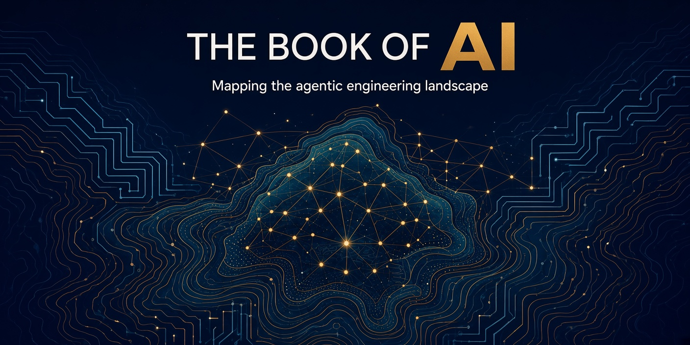

<div align="center">
  
</div>

# The Book of AI

> **See how deep the rabbit hole goes:** A practical manual for agentic engineering and building your own stack for local LLM sovereignty.

:notebook: **[Read Online: The Book of AI](https://the-book-of-ai.github.io/source)** | :map: **[Chapter Overview](chapter-structure.qmd)** | :calendar: **[Monthly Digest](https://the-book-of-ai.github.io/source/digest/digest_index.html)** | :tv: **[Daily YouTube Digest](https://the-book-of-ai.github.io/youtube-feed-dashboard-ai/)**

---

> :construction: **Under Heavy Construction** :construction:  
> This book is a living work in progress (started 2025-02). Chapters are actively being drafted, revised, and backed by primary sources.

---

## About This Book

*The Book of AI* is an opinionated, signal-from-noise reference manual for engineers and technical practitioners building and operating AI agent systems. It focuses on repeatable agent harnesses, cutting through benchmark hype, and building a practical, sovereign local LLM toolkit rather than relying on black-box SaaS wrappers.

| | |
| :--- | :--- |
| **Who it's for** | Engineers and technical practitioners building and working with AI agents. |
| **What it is** | A curated, maintained architecture and reference manual for agentic systems engineering. |
| **Why it exists** | To provide a single, evidence-backed source of truth instead of scattered blog posts, repos, and hype cycles. |

### What You'll Build & Learn

- **Model Evaluation:** Cutting through marketing claims to understand model capabilities and trade-offs.

- **Local LLM Sovereignty:** Running and managing local models on your own hardware.
- **Agents & Harnesses:** Designing repeatable, reliable agentic harnesses.
- **A Working Stack:** Assembling an end-to-end, practical toolkit for agentic engineering.

*(**Prerequisites:** Assumes comfort with the command line, basic software engineering workflows, and a willingness to self-host or run local models. Specific hardware/environment notes are covered in Chapter 3.)*

---

## Start Here (What's Ready Now)

Because the book is actively being written, these sections are the best places to jump in today:

1. **[Prompt Engineering Notes](https://the-book-of-ai.github.io/source)** — *Status: Final*
2. **[Chapter 7: Resources](https://the-book-of-ai.github.io/source)** — *Status: Review*
3. **[Monthly Digest Catalog](https://the-book-of-ai.github.io/source/digest/digest_index.html)** — Dated snapshots of current tools and ideas.
4. **[Daily YouTube Digest](https://the-book-of-ai.github.io/youtube-feed-dashboard-ai/)** — Curated videos on agentic engineering.

---

## Book Progress

| Section | Title | Status | Activity |
| :--- | :--- | :--- | :---: |
| Index | Main page | revising | :yellow_circle: |
| Chapter 1 | Introduction | notes | :red_circle: |
| Chapter 2 | Models | draft | :green_circle: |
| Chapter 3 | Running local models | draft | :yellow_circle: |
| Chapter 4 | Agents and Harnesses | draft | :red_circle: |
| Chapter 5 | Building a working stack | notes | :yellow_circle: |
| Chapter 6 | Miscellaneous Tools | notes | :red_circle: |
| Chapter 7 | Resources | review | :yellow_circle: |
| Appendix | Glossary | revising | :yellow_circle: |
| Appendix | Prompt Engineering Notes | final | :red_circle: |
| Appendix | Digest Catalog | draft | :yellow_circle: |
| Appendix | Bibliography | draft | :yellow_circle: |

<details>
<summary><strong>Status & Activity Key</strong></summary>

**Status**

- **notes:** Scattered notes / pre-writing outline.
- **outline:** Structured outline exists; ready to draft.
- **rough draft:** Early content written, still rough.
- **draft:** First full draft written; needs editing.
- **revising:** Actively editing and rewriting.
- **review:** Ready for feedback and polishing.
- **final:** Considered complete (minor tweaks only).

**Activity**

- :green_circle: **Active:** Primary current focus.
- :yellow_circle: **In Progress:** Periodic updates and edits.
- :red_circle: **Paused / Idle:** Not currently in active focus.

</details>

---

## Philosophy & Quotes

> *"Not all benchmarks lie, but all liars benchmark."*

> *"GPU sovereignty is the new second amendment."* — DHH

---

## Contributing & Building Locally

This book is built with [Quarto](https://quarto.org/). Chapters and appendices are Quarto Markdown (`.qmd`) files, and [`_quarto.yml`](_quarto.yml) defines the reading order and publishing settings.

```bash
# Build the website locally (outputs to docs/)
quarto render
